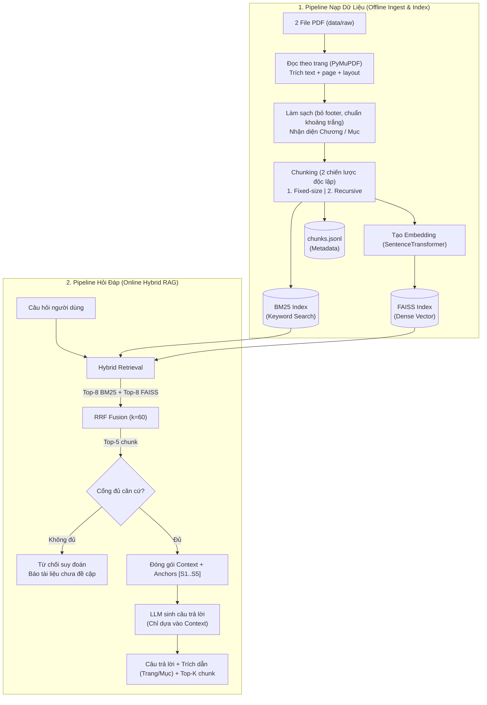

# Architecture.md — Hybrid RAG cho Trợ lý hỏi đáp tài liệu học tập

> Tài liệu thiết kế cho **Project 1** (Chuyên đề CNTT — UTC).
> Kế thừa khung pipeline Hybrid RAG (BM25 + FAISS + RRF + Cổng từ chối) và tối ưu hóa trực tiếp cho đặc thù của 2 giáo trình đầu vào.
> **Tiêu chí thiết kế:** Thực tế, tinh gọn, bám sát dữ liệu và mục tiêu đề bài, tránh over-engineering và không thêm công nghệ phức tạp ngoài phạm vi.

---

## 1. Tổng quan bài toán

| Mục                     | Nội dung                                                                                           |
| ----------------------- | -------------------------------------------------------------------------------------------------- |
| **Bài toán**            | Hỏi đáp trên giáo trình: định nghĩa, giải thích, ví dụ, so sánh khái niệm, tìm theo chương/trang   |
| **Dữ liệu**             | 2 PDF: Giáo trình Học máy (tiếng Việt, 60 trang) và Database Design (tiếng Anh, 48 trang)          |
| **Retrieval**           | **Hybrid Search**: BM25 (Keyword) + FAISS (Dense Vector) hợp nhất qua RRF                          |
| **Chiến lược Chunking** | Đối sánh **02 chiến lược**: `fixed` (cắt cố định, baseline) và `recursive` (nhận diện chương/mục)  |
| **Đầu ra**              | Câu trả lời + trích dẫn chuẩn (`Nguồn: <tài liệu>, <chương/mục>, trang <số>`) + Top-K chunk căn cứ |

**Tại sao chọn Hybrid Search cho bộ dữ liệu này:**

- Hai cuốn sách chứa nhiều **thuật ngữ kỹ thuật cố định** (_"candidate key"_, _"data redundancy"_, _"độ chệch"_, _"tập phát triển"_...) $\rightarrow$ BM25 tìm chính xác từ khóa.
- Dữ liệu song ngữ (câu hỏi tiếng Việt có thể cần tìm nội dung trong sách CSDL tiếng Anh) và câu hỏi dạng diễn đạt lại $\rightarrow$ Vector embedding đa ngôn ngữ đảm nhiệm tìm kiếm theo ngữ nghĩa.
- **RRF (Reciprocal Rank Fusion)** xếp hạng theo thứ tự thay vì cộng điểm thô (do BM25 score và Cosine similarity lệch thang đo).

---

## 2. Phân tích dữ liệu đầu vào (Data Profile)

Hai giáo trình đã được cắt trang chuẩn bị sẵn tại `books/processed/`:

| Thuộc tính              | `ml_yearning_vi`                                    | `db_design_en`                                        | Xử lý phù hợp                                                   |
| ----------------------- | --------------------------------------------------- | ----------------------------------------------------- | --------------------------------------------------------------- |
| **File**                | `book_mly_with_cover_vn-5-64.pdf`                   | `Database-Design-2nd-Edition-1660153697-10-57.pdf`    | Đặt tại `data/raw/`                                             |
| **Nội dung**            | Machine Learning: 35 chương ngắn (1–2 trang/chương) | Database Design: Chương 1–8                           | Cấu trúc phân mảnh theo chương rõ nét                           |
| **Ngôn ngữ**            | Tiếng Việt (chứa nhiều từ mượn tiếng Anh)           | Tiếng Anh                                             | Cần SentenceTransformer đa ngôn ngữ                             |
| **Số trang PDF**        | 60 trang (tính từ 1)                                | 48 trang (tính từ 1)                                  | `page`: số trang PDF                                            |
| **Số trang in sách**    | Trang in = Trang PDF + 3 (`page_label = page + 3`)  | Trang in = Trang PDF (`page_label = page`)            | Giữ cả `page` và `page_label` để mở PDF chính xác               |
| **Chân trang (Footer)** | Dòng chỉ chứa số trang lẻ                           | `N \| Chapter ...` hoặc `Chapter ... \| N`            | Loại bỏ bằng Regex lúc làm sạch                                 |
| **Đặc thù khối**        | Có chú thích `CHÚ THÍCH:`, bảng, hình ảnh           | Có khối **Key Terms**, **Exercises**, **Attribution** | Gắn nhãn `block_type` để ưu tiên định nghĩa, hạ ưu tiên bài tập |
| **Ngắt dòng từ ghép**   | Tiếng Việt ít bị lỗi hyphen                         | Một số từ ghép bị mất gạch nối cuối dòng              | Giữ nguyên từ ngữ, xử lý nối dòng cơ bản                        |

---

## 3. Kiến trúc hệ thống tổng thể



---

## 4. Metadata Schema (Đơn giản, đúng chuẩn)

Không tạo quá nhiều trường phức tạp, chỉ giữ các trường cần thiết phục vụ truy vết và kiểm chứng:

```python
from pydantic import BaseModel

class Chunk(BaseModel):
    chunk_id: int             # ID số nguyên duy nhất (thống nhất giữa BM25 & FAISS)
    text: str                 # Nội dung đoạn văn bản
    source: str               # Tên file PDF nguồn
    doc_id: str               # "ml_yearning_vi" hoặc "db_design_en"
    page: int                 # Trang PDF (bắt đầu từ 1, dùng để đối chiếu file)
    page_label: str           # Số trang in trên sách (để người dùng dễ lật sách)
    section: str              # Chương/mục ("Chương 5" hoặc "Chapter 8 > Keys")
    strategy: str             # "fixed" hoặc "recursive"
    block_type: str = "content"  # "content" | "key_terms" | "exercises"
```

---

## 5. Chiến lược Chunking (Đối sánh 2 phương án)

Chỉ cài đặt và so sánh **2 chiến lược** theo đúng yêu cầu đề bài:

### 5.1. `fixed` (Baseline — Cắt theo kích thước cố định)

- Cắt văn bản tuần tự theo độ dài cố định: `chunk_size ≈ 256` tokens/từ, `overlap = 35` (khoảng 15%).
- Không quan tâm ranh giới câu hay chương (đây là nhược điểm chủ đích để so sánh với Recursive).
- Metadata `page` và `section` được lấy theo vị trí đầu của chunk.

### 5.2. `recursive` (Chiến lược chính — Nhận diện cấu trúc)

- Tách văn bản theo phân cấp cấu trúc tự nhiên:
  1. **Ranh giới chương** (không bao giờ gộp 2 chương vào 1 chunk).
  2. **Tiêu đề mục / Heading** (dựa vào font size / chữ đậm lúc parse PDF).
  3. **Đoạn văn** (`\n\n`).
  4. **Câu** (`. `, `? `, `! `).
- Gom các câu/đoạn lại đến độ dài mục tiêu `target ≈ 300` tokens, giới hạn `max ≈ 450` tokens.
- Giữ nguyên khối định nghĩa hoặc bullet point, không cắt ngang câu.

---

## 6. Embedding & Indexing

1. **Embedding Model:**
   - Sử dụng mô hình đa ngôn ngữ gọn nhẹ chạy tốt trên cả CPU/GPU: `BAAI/bge-m3` hoặc `keepitreal/vietnamese-sbert` / `intfloat/multilingual-e5-base`.
   - Chuẩn hóa vector ($L_2$ normalize) trước khi nạp vào FAISS.
2. **Dense Index (FAISS):**
   - Sử dụng `faiss.IndexFlatIP` bọc trong `faiss.IndexIDMap`.
   - ID trong FAISS chính là `chunk_id`.
3. **Keyword Index (BM25):**
   - Sử dụng `rank_bm25.BM25Okapi`.
   - Tokenizer chuẩn hóa: chữ thường, loại bỏ ký tự đặc biệt thừa, tách từ bằng regex đơn giản (`re.findall(r'\w+', text.lower())`).
   - Mảng ID của BM25 khớp chính xác thứ tự `chunk_id` của FAISS:
     $$\{id_{faiss}\} \equiv \{id_{bm25}\} \equiv \{chunk.chunk\_id\}$$

---

## 7. Hybrid Retrieval & RRF Fusion

1. **Truy vấn đồng thời:**
   - BM25 tìm kiếm ra Top-8 chunk IDs.
   - FAISS tìm kiếm ra Top-8 chunk IDs.
2. **Hợp nhất bằng RRF (Reciprocal Rank Fusion):**
   - Với hằng số $k = 60$:
     $$RRF(c) = \sum_{r \in \{BM25, FAISS\}} \frac{1}{60 + rank_r(c)}$$
   - Sắp xếp điểm $RRF(c)$ giảm dần và lấy **Top-5** chunk cao nhất.
3. **Cổng đủ căn cứ (Evidence Gate):**
   - Nếu điểm tương đồng tối đa của Top-1 quá thấp (câu hỏi nằm ngoài phạm vi tài liệu), hệ thống sẽ trả về câu từ chối theo mẫu thay vì suy đoán.

---

## 8. Generation & Trích dẫn (Citation)

### Prompt khuôn mẫu:

```
Bạn là trợ lý học tập hỏi đáp giáo trình. Hãy trả lời câu hỏi dựa HOÀN TOÀN vào các đoạn ngữ cảnh (CONTEXT) dưới đây.
- Tuyệt đối không tự suy đoán thông tin ngoài CONTEXT.
- Nếu CONTEXT không chứa đủ thông tin để trả lời, hãy trả lời rõ: "Tài liệu hiện tại không có đủ thông tin để trả lời câu hỏi này."
- Với mỗi thông tin đưa ra, phải trích dẫn nguồn theo nhãn [S1], [S2] tương ứng.

CONTEXT:
[S1] Nguồn: {document_title} | {section} | Trang {page_label} (PDF tr. {page})
{text_chunk_1}

[S2] Nguồn: {document_title} | {section} | Trang {page_label} (PDF tr. {page})
{text_chunk_2}
...

CÂU HỎI: {query}
CÂU TRẢ LỜI:
```

### Định dạng đầu ra:

- Nội dung trả lời ngắn gọn, chuẩn xác.
- Khối trích dẫn rõ ràng:
  `Nguồn: Database Design, Chapter 8 > Keys, trang 37 (PDF tr. 37)`

---

## 9. Giao diện Ứng dụng Demo (Streamlit)

Giao diện trực quan, dễ sử dụng, bao gồm:

1. **Thanh bên (Sidebar):**
   - Chọn tài liệu tra cứu (Cả hai, Học máy, hoặc CSDL).
   - Chọn chiến lược Chunking để đối sánh (`fixed` vs `recursive`).
   - Chọn chế độ Retrieval (`hybrid_rrf`, `faiss_only`, `bm25_only`).
   - Tùy chọn xem Top-K trước hoặc sau câu trả lời.
2. **Khung chính:**
   - Ô nhập câu hỏi + Gợi ý các câu hỏi mẫu (định nghĩa, so sánh, tìm theo chương/trang).
   - Hiển thị câu trả lời của LLM và trích dẫn trang.
   - Khối expander xem chi tiết Top-K đoạn trích căn cứ (điểm RRF, text, vị trí).
   - Bảng thống kê mini: Thời gian truy vấn, số chunk được nạp, độ dài ngữ cảnh.

---

## 10. Kế hoạch Đánh giá (Evaluation)

- **File câu hỏi:** `data/eval/eval_questions.csv` gồm **15 câu hỏi** theo đúng barem:
  - 5 câu hỏi từ khóa (Keyword match).
  - 5 câu hỏi diễn đạt lại (Paraphrase).
  - 5 câu hỏi tổng hợp (Synthesis, có $\ge 3$ câu cần thông tin từ nhiều chunk).
  - Kèm 2 câu hỏi ngoài phạm vi để kiểm tra cổng từ chối.
- **Chỉ số đo lường:**
  - **Precision@3** và **Recall@3** (đo đạc tự động qua script `evaluate.py`).
  - Đánh giá câu trả lời (Đúng, Đầy đủ, Bám nguồn, Citation chuẩn).
  - Phân tích 3 trường hợp: 1 case thành công, 1 case thất bại, 1 case 2 chiến lược chunking cho kết quả khác nhau.

---

## 11. Cấu trúc thư mục tinh gọn

```
Hybrid_RAG/
├── Agent.md                 # Hướng dẫn chi tiết các bước triển khai
├── Architecture.md          # Tài liệu kiến trúc này
├── README.md                # Hướng dẫn cài đặt & sử dụng
├── Makefile                 # Các lệnh thực thi nhanh (setup, ingest, app, eval)
├── pyproject.toml           # Khai báo thư viện (dependencies)
├── .env.example             # Cấu hình API key (LLM_API_KEY, LLM_MODEL)
├── .gitignore
├── configs/
│   └── default.yaml         # File cấu hình tham số chung
├── data/
│   ├── raw/                 # 2 file PDF gốc
│   ├── interim/             # Dữ liệu trang sau khi parse
│   ├── processed/           # chunks.jsonl của fixed & recursive
│   └── eval/                # eval_questions.csv & kết quả đánh giá
├── indexes/                 # Lưu trữ FAISS index & BM25 index theo từng strategy
├── src/hybridrag/           # Package mã nguồn chính (chỉ gồm 6 file mạch lạc)
│   ├── __init__.py
│   ├── config.py            # Đọc config YAML & env
│   ├── schemas.py           # Pydantic schemas (Chunk, PageRecord)
│   ├── ingest.py            # Đọc PDF, làm sạch, tách chương/mục
│   ├── chunking.py          # Fixed & Recursive chunking
│   ├── indexer.py           # SentenceTransformer embed, FAISS, BM25
│   ├── retrieval.py         # BM25 + FAISS + RRF fusion
│   └── generator.py         # LLM prompt, sinh câu trả lời, trích dẫn
├── app.py                   # Ứng dụng Streamlit
└── evaluate.py              # Script chạy đánh giá tự động Precision/Recall@3
```
